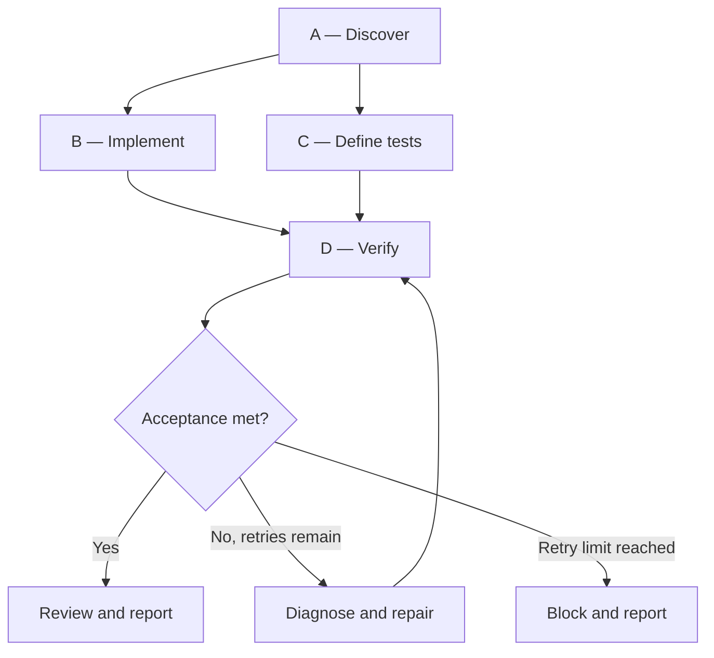

# GHDL graph contract

## Representation

Use Mermaid for the human-readable graph in `ghdl/graph.md`. Track actual node status separately in `ghdl/run-state.md`.

Example:

This graph is a plan, not an executable scheduler. Repair is a bounded retry policy, not an unbounded dependency cycle.

## Node fields

| Field | Purpose |
|---|---|
| `id` | Stable identifier within the run |
| `goal` | One observable outcome |
| `depends_on` | Nodes that must complete first |
| `inputs` | Files, decisions, or artifacts consumed |
| `outputs` | Files or evidence produced |
| `done_when` | Observable completion predicate |
| `status` | `PENDING`, `READY`, `RUNNING`, `PASS`, `FAIL`, `BLOCKED`, `SKIPPED` |
| `attempts` | Execution count |
| `owner` | Orchestrator, worker/agent, or human |

## Invariants

- Dependencies form a DAG.
- A node is `READY` only when its dependencies are `PASS`, or a documented and verified alternative supplies the required input.
- `SKIPPED` is not equivalent to `PASS`.
- `PASS` requires evidence such as a command result, artifact, test output, or explicit human decision.
- A failed node does not satisfy downstream dependencies.
- Human approval is an explicit gate, never inferred.
- Re-plan and increment graph revision when scope or facts change.
- Do not claim parallelism unless the actual runtime executes work concurrently.

## Graph sizing

Keep the graph small enough to inspect. Create a node when work has a meaningful independent output, dependency, risk boundary, or verification predicate. Avoid one node per shell command.
