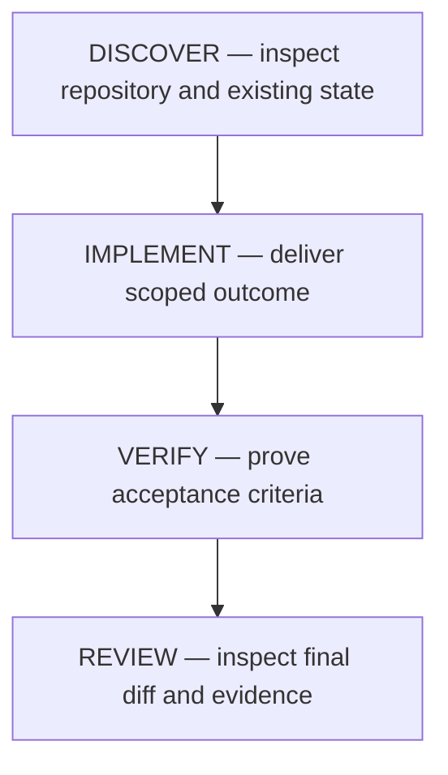

# Execution graph — {{ITEM_ID}}

- Item: {{ITEM_ID}}
- Revision: 1
- Updated: {{DATE}}
- Purpose: describe the dependency order for this delivery slice.

## DAG

## Node contracts

| Node ID | Type | Depends on | Goal | Inputs | Outputs | Completion predicate |
|---|---|---|---|---|---|---|
| DISCOVER | inspect | — | Understand relevant code, constraints, current changes, and checks | User request, project instructions, source, Git state | Findings recorded in run state | Relevant context and existing changes are recorded; verification commands are identified |
| IMPLEMENT | implement | DISCOVER | Deliver the work item within its agreed scope | Work item, findings | Scoped implementation and tests | Planned change is present; no unrelated changes were introduced |
| VERIFY | verify | IMPLEMENT | Prove every acceptance criterion | Implementation, acceptance criteria, verification commands | Test/check results and acceptance evidence | Every required criterion has evidence; failed or unavailable checks are explicitly recorded |
| REVIEW | review | VERIFY | Review the complete change and evidence | Diff, work item, run state | Review findings and final decision | No unresolved critical issue; claims match evidence |

<!-- Add, remove, or split nodes to match the task. Keep this table and the run-state node table synchronized. -->
