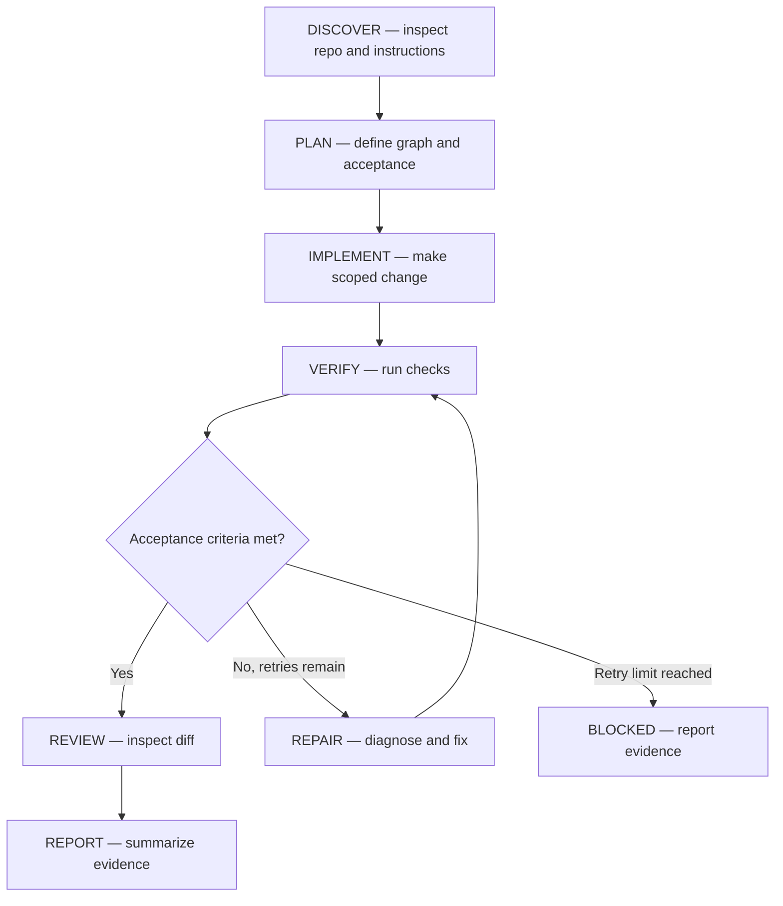

# GHDL execution graph

- Task:
- Graph revision: 1
- Last updated:

## Node contracts

| ID | Goal | Depends on | Inputs | Outputs | Done when | Owner |
|---|---|---|---|---|---|---|
| DISCOVER | Understand relevant repository context | — | Instructions, source, Git status | Repository findings | Relevant constraints and checks recorded | Orchestrator |
| PLAN | Define task and graph | DISCOVER | Findings, user request | Task contract, graph | Scope and acceptance criteria are checkable | Orchestrator |
| IMPLEMENT | Make the scoped change | PLAN | Task contract | Source changes | Planned changes are present | Worker |
| VERIFY | Test the change | IMPLEMENT | Diff, test/build commands | Verification evidence | Declared checks have results | Worker |
| REVIEW | Review final diff | VERIFY | Diff, acceptance criteria, test results | Review findings | No unresolved critical issue | Orchestrator |
| REPORT | Communicate outcome | REVIEW | All artifacts and evidence | Final report | Status accurately reflects evidence | Orchestrator |
