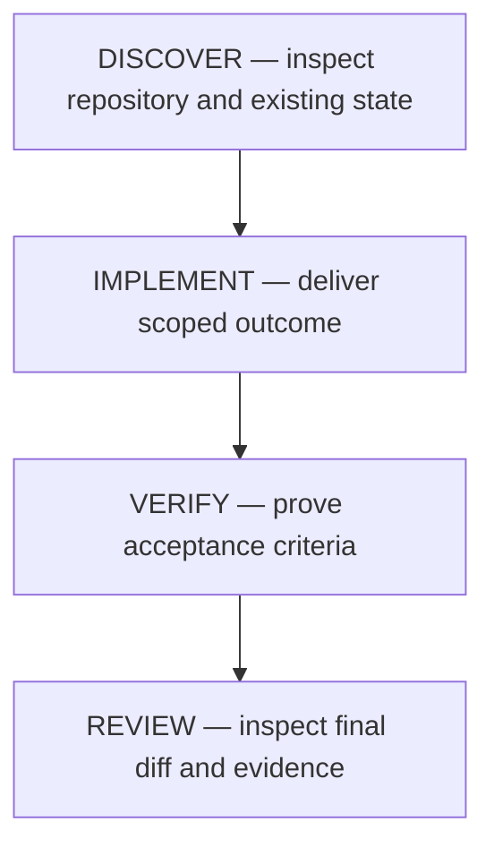

# Execution graph — GHDL-20261112-21_52_36

- Item: GHDL-20261112-21_52_36
- Revision: 1
- Updated: 2026-11-12
- Purpose: describe the dependency order for this delivery slice.

## DAG

## Node contracts

| Node ID   | Type      | Depends on | Goal                                                                                                                                                                                                                                     | Inputs                                                     | Outputs                                               | Completion predicate                                                                                                                                                              |
| --------- | --------- | ---------- | ---------------------------------------------------------------------------------------------------------------------------------------------------------------------------------------------------------------------------------------- | ---------------------------------------------------------- | ----------------------------------------------------- | --------------------------------------------------------------------------------------------------------------------------------------------------------------------------------- |
| DISCOVER  | inspect   | —          | Understand relevant code, constraints, current changes, and checks                                                                                                                                                                       | User request, project instructions, source, Git state      | Findings recorded in run state                        | Relevant context and existing changes are recorded; verification commands are identified                                                                                          |
| IMPLEMENT | implement | DISCOVER   | Restore ghdl.py from HEAD and re-apply only the functional hunks (timestamp IDs + collision suffixes, --id-suffix arg, ID_RE/INDEX_LINE_RE, validation message, migrate-feature removal, import cleanup) without any line-wrapping noise | Work item, findings, original file at HEAD                 | Clean working-tree diff limited to functional changes | git diff of ghdl.py contains only the intended hunks; no unrelated reformatting remains                                                                                           |
| VERIFY    | verify    | IMPLEMENT  | Prove every acceptance criterion                                                                                                                                                                                                         | Implementation, acceptance criteria, verification commands | Test/check results and acceptance evidence            | Every required criterion has evidence: compile check, full unittest suite (16 tests), validate, grep for migrate/legacy traces, end-to-end ID allocation incl. collision suffixes |
| REVIEW    | review    | VERIFY     | Review the complete change and evidence                                                                                                                                                                                                  | Diff, work item, run state                                 | Review findings and final decision                    | No unresolved critical issue; claims match evidence; other files' diffs untouched                                                                                                 |

<!-- Add, remove, or split nodes to match the task. Keep this table and the run-state node table synchronized. -->
